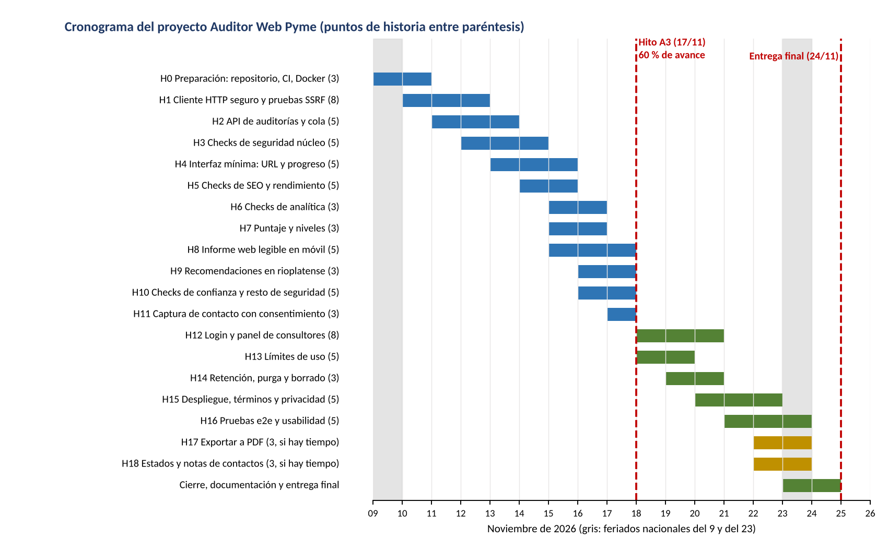

# Planificación y seguimiento

Aplica las técnicas de planificación de Taller de Proyectos I: estructura de desglose del trabajo (EDT), cronograma tipo Gantt, tablero Kanban, hitos y control de desvíos.

## 1. Metodología

Scrum liviano con entregas incrementales. El trabajo se organiza en historias con puntos de esfuerzo y se sigue en un tablero Kanban con las columnas **Pendiente, En curso, En revisión y Hecho** (por ejemplo, en GitHub Projects). Una historia está **hecha** cuando cumple la definición de hecho del documento de requisitos: pruebas en verde, revisión realizada, documentación y trazabilidad al día.

## 2. Estructura de desglose del trabajo (EDT)

```
1. Auditor Web Pyme
   1.1 Gestión
       1.1.1 Planificación y seguimiento
       1.1.2 Documentación (requisitos, plan, pruebas, mantenimiento)
   1.2 Análisis y diseño            (Avances 1 y 2: completado)
   1.3 Núcleo seguro
       1.3.1 Cliente HTTP seguro y pruebas SSRF          (H1)
       1.3.2 API de auditorías y cola                     (H2)
   1.4 Checks de auditoría
       1.4.1 Seguridad                                    (H3, H10)
       1.4.2 SEO y rendimiento                            (H5)
       1.4.3 Analítica                                    (H6)
       1.4.4 Confianza y contacto                         (H10)
       1.4.5 Puntaje y recomendaciones                    (H7, H9)
   1.5 Interfaz web
       1.5.1 Solicitud y progreso                         (H4)
       1.5.2 Informe                                      (H8, H17)
   1.6 Negocio y administración
       1.6.1 Captura de contactos                         (H11)
       1.6.2 Panel de consultores                         (H12, H18)
   1.7 Seguridad y cumplimiento
       1.7.1 Límites de uso                               (H13)
       1.7.2 Retención y borrado                          (H14)
   1.8 Despliegue y calidad
       1.8.1 Despliegue, términos y privacidad            (H15)
       1.8.2 Pruebas e2e y de usabilidad                  (H16)
```

## 3. Backlog con puntos

Total de la versión entregable: **85 puntos**. Prioridad: M (debe) o S (debería). Estado: Pendiente, En curso, En revisión o Hecho.

| ID | Historia | Requisitos | Pts. | Prior. | Estado |
|---|---|---|---|---|---|
| H0 | Preparación: repositorio, integración continua, Docker base | RNF-04, 10, 11, 12 | 3 | M | Hecho |
| H1 | Cliente HTTP seguro y suite de pruebas SSRF | RF-02, RNF-01, 13 | 8 | M | En revisión |
| H2 | API de auditorías, cola y estado | RF-01, RF-09 | 5 | M | Pendiente |
| H3 | Checks de seguridad núcleo (SEC-01 a 05 y 07 a 09) | RF-03 | 5 | M | Pendiente |
| H4 | Interfaz mínima: URL, progreso y resultados | RF-01, RF-08 | 5 | M | Pendiente |
| H5 | Checks de SEO y rendimiento liviano | RF-04 | 5 | M | Pendiente |
| H6 | Checks de analítica | RF-05 | 3 | M | Pendiente |
| H7 | Puntaje por categoría y global | RF-07 | 3 | M | Pendiente |
| H8 | Informe web legible en móvil | RF-08, RNF-03, 08 | 5 | M | Pendiente |
| H9 | Recomendaciones en español rioplatense | RF-19 | 3 | S | Pendiente |
| H10 | Checks de confianza y resto de seguridad | RF-03, RF-06 | 5 | S | Pendiente |
| H11 | Captura de contacto con consentimiento | RF-11, RNF-05 | 3 | M | Pendiente |
| H12 | Inicio de sesión y panel de consultores | RF-12, RNF-02 | 8 | M | Pendiente |
| H13 | Límites de uso por IP, dominio y día | RF-15 | 5 | M | Pendiente |
| H14 | Retención, purga y borrado de datos | RF-16, RNF-05 | 3 | M | Pendiente |
| H15 | Despliegue con Docker, HTTPS, términos y privacidad | RNF-11 | 5 | M | Pendiente |
| H16 | Pruebas e2e y prueba de usabilidad | RNF-06, 07, 08 | 5 | M | Pendiente |
| H17 | Exportar el informe a PDF | RF-10 | 3 | S | Pendiente |
| H18 | Estados y notas de contactos | RF-14 | 3 | S | Pendiente |
| | **Total** | | **85** | | |

Quedan fuera de la versión entregable: comparación de auditorías (RF-13), TOTP, verificación de dominio y monitoreo programado.

## 4. Cómo se mide el avance del 60 %

`Avance = puntos de historias hechas / 85 × 100`. La meta del Avance 3 es **51 puntos (60 %)**. Según el plan de trabajo ([PLAN_DE_TRABAJO.md](PLAN_DE_TRABAJO.md)) se supera esa meta al cerrar la etapa 5 (61 puntos), y el Avance 3 se entrega en ese momento. Si al cerrar la etapa 4 los puntos reales son menores a 45, se aplican las reglas de recorte de ese documento.

## 5. Plan por etapas

El ritmo lo marca el tiempo dedicado: cada etapa termina cuando cumple su puerta de salida, no por una fecha fija. El límite de la plataforma para las entregas es el 1/12.



| Etapa | Historias | Puntos de la etapa | Acumulado planificado | Puerta de salida |
|---|---|---|---|---|
| 1 | H0, H1 | 11 | 11 | Integración continua en verde y suite SSRF completa |
| 2 | H2, H3, H4 | 15 | 26 | Rebanada vertical: URL local, auditoría y hallazgos de seguridad en el navegador |
| 3 | H5, H6, H7 | 11 | 37 | Auditoría con puntaje por categoría y global |
| 4 | H8, H9, H10 | 13 | 50 | Informe completo y legible en móvil |
| 5 | H11, H12 | 11 | 61 | Contacto con consentimiento y panel con sesión (supera el 60 %) |
| 6 | H13, H14, H15 | 13 | 74 | Aplicación desplegada con HTTPS, límites de uso y purga |
| 7 | H16, H17, H18 y cierre | 11 | 85 | Pruebas e2e y de usabilidad, documentación al día |

Hitos de la materia: **Avance 3** (60 %, al cerrar la etapa 5) y **entrega final** (proyecto completo, al cerrar la etapa 7).

## 6. Control de desvíos

Al cerrar cada etapa se anotan la fecha y las horas dedicadas, y se compara el avance planificado con el real. Con estos datos se ve el ritmo real y se ajusta el resto del plan. Si el desvío supera 5 puntos, se anota la causa y la acción correctiva.

| Etapa | Fecha de cierre | Horas dedicadas | Puntos planificados (acumulado) | Puntos reales (acumulado) | Desvío | Causa y acción |
|---|---|---|---|---|---|---|
| 1 | | | 11 | | | |
| 2 | | | 26 | | | |
| 3 | | | 37 | | | |
| 4 | | | 50 | | | |
| 5 | | | 61 | | | |
| 6 | | | 74 | | | |
| 7 | | | 85 | | | |

## 7. Riesgos

El análisis completo está en [PLAN_DE_DESARROLLO.md](PLAN_DE_DESARROLLO.md), sección 9. Los dos que más afectan al calendario son el plazo corto y las fallas en el cliente HTTP seguro, que bloquearían el resto de las historias.
